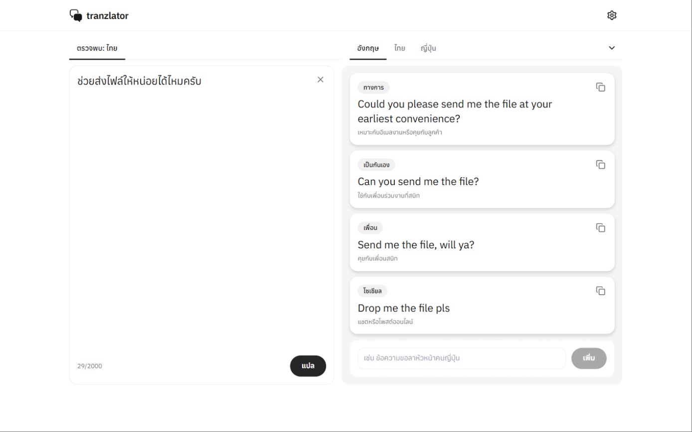
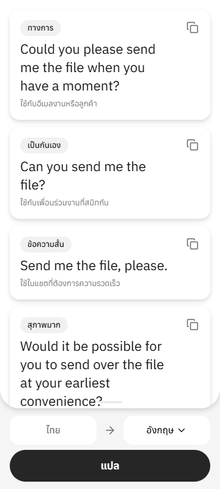

# tranzlator

แปลภาษาแบบเข้าใจบริบท — พิมพ์ข้อความครั้งเดียว ได้คำแปลหลายแบบแยกตามบริบท (ทางการ, เป็นกันเอง, คุยกับเพื่อน, โพสต์โซเชียล …) แล้วเพิ่มบริบทที่ต้องการเองได้ รองรับ 190+ ภาษา ใช้ AI ที่คุณเลือกด้วย API key ของคุณเอง ฟรีและ open source

<p>
  <a href="https://github.com/Rujfaha/tranzlator/releases/latest/download/tranzlator.apk"></a>
  <a href="https://tranzlator.ruijtech59.workers.dev"></a>
  <a href="https://github.com/Rujfaha/tranzlator/releases"></a>
</p>

<p>
  
  
</p>

## ติดตั้งบน Android

1. กดปุ่ม **ดาวน์โหลด APK** ด้านบนบนมือถือ (หรือไปที่ [Releases](https://github.com/Rujfaha/tranzlator/releases/latest) แล้วเลือก `tranzlator.apk`)
2. เปิดไฟล์ที่ดาวน์โหลด ถ้าระบบถาม ให้อนุญาต "ติดตั้งแอปจากแหล่งที่ไม่รู้จัก" สำหรับเบราว์เซอร์หรือแอปไฟล์ที่ใช้เปิด
3. เปิดแอป → ไอคอนตั้งค่า → เลือกผู้ให้บริการ AI และใส่ API key ของคุณ

APK ถูก build อัตโนมัติโดย GitHub Actions (`.github/workflows/android.yml`) ทุกครั้งที่ push เข้า `main` และเซ็นด้วยคีย์ส่วนตัวของโปรเจกต์ (อัปเดตทับเวอร์ชันเดิมได้) ดาวน์โหลดจากลิงก์ในหน้านี้หรือหน้า Releases เท่านั้น

ถ้าเคยติดตั้งเวอร์ชันทดสอบรุ่นแรก (ที่ release notes ไม่มีคำว่า signed) แล้วติดตั้งทับไม่ได้ ให้ถอนการติดตั้งเวอร์ชันนั้นก่อน

## สำหรับนักพัฒนา

โค้ดชุดเดียว (Expo + NativeWind) ส่วนเว็บและ API รันบน Cloudflare Worker ตัวเดียว (static assets + `/api/*` + D1)

ออกแบบและแผนงาน: `docs/superpowers/specs/` และ `docs/superpowers/plans/`

## API key ของคุณ

แอปนี้ไม่มี API key ของโปรเจกต์ ผู้ใช้เลือกผู้ให้บริการ (Anthropic, Google Gemini, OpenAI, OpenRouter) แล้วใส่ key ของตัวเองในหน้าตั้งค่า

- key เก็บในเครื่องของผู้ใช้เท่านั้น: เว็บใช้ `localStorage` ของเบราว์เซอร์, Android ใช้ `expo-secure-store`
- key ถูกส่งไปกับทุกคำขอใน header `X-AI-Key` ผ่าน Worker ไปยังผู้ให้บริการที่ผู้ใช้เลือก แล้วถูกทิ้งทันที Worker ไม่บันทึก ไม่ log และไม่ส่ง key กลับใน response ใดๆ
- Worker เรียกได้เฉพาะ URL ของผู้ให้บริการทั้งสี่ที่กำหนดตายตัวใน `worker/ai.ts`
- ข้อความที่แปลและผลแปลที่ AI เลือกถูก cache ใน D1 (คีย์ = โมเดล + ภาษาปลายทาง + ข้อความ) ผู้ใช้คนอื่นที่แปลข้อความเดียวกันด้วยโมเดลเดียวกันจะได้ผลเดิมโดยไม่เรียก AI ซ้ำ อย่าใส่ข้อมูลลับในข้อความที่แปล
- บริบทที่ผู้ใช้เพิ่มเองไม่ถูกเก็บในเซิร์ฟเวอร์ อยู่ในหน้าจอนั้นเท่านั้น

## พัฒนาในเครื่อง

```bash
npm install
npm test            # vitest (Worker + client logic)
npm run typecheck

# เว็บ + Worker จริงในเครื่อง (same-origin)
npm run build:web
npx wrangler d1 migrations apply tranzlator --local
npx wrangler dev    # http://localhost:8787
```

หมายเหตุ: Worker ไม่เปิด CORS จึงใช้ `expo start --web` ชี้ไปยัง Worker คนละ origin จากเบราว์เซอร์ไม่ได้ ให้ใช้ขั้นตอนข้างบน (Android APK เป็น native จึงไม่ติดข้อจำกัดนี้)

## Deploy ขึ้น Cloudflare

ต้องมีบัญชี Cloudflare ทำตามลำดับ:

```bash
npx wrangler login
npx wrangler d1 create tranzlator
```

คัดลอก `database_id` ที่ได้ไปใส่ใน `wrangler.jsonc` ที่รายการ `d1_databases` เดิม (เพิ่มบรรทัด `"database_id": "<id>"`) แล้ว

```bash
npm run db:migrate   # สร้างตารางใน D1 จริง
npm run deploy       # export เว็บ แล้ว wrangler deploy
```

ได้ URL แบบ `https://tranzlator.<บัญชี>.workers.dev` เปิดแล้วใส่ key ของตัวเองในหน้าตั้งค่า

Rate limit 20 ครั้ง/นาที/IP ตั้งใน `wrangler.jsonc` (`ratelimits`)

### Deploy อัตโนมัติจาก GitHub

`.github/workflows/deploy.yml` รัน typecheck + เทสต์ทุก push/PR และเมื่อ push เข้า `main` จะ migrate D1 แล้ว deploy ให้เอง ต้องตั้ง repository secrets 2 ตัว (Settings → Secrets and variables → Actions):

- `CLOUDFLARE_API_TOKEN` — สร้างจาก Cloudflare dashboard → My Profile → API Tokens → template "Edit Cloudflare Workers" แล้วเพิ่มสิทธิ์ Account → D1 → Edit
- `CLOUDFLARE_ACCOUNT_ID` — ดูได้จาก `npx wrangler whoami`

ถ้า fork ไปใช้เอง ต้องเปลี่ยน `database_id` ใน `wrangler.jsonc` เป็นของบัญชีตัวเองด้วย

## Android APK

GitHub Actions build ให้อัตโนมัติ (ดูด้านบน) โดยชี้ API ไปที่ Worker ของ repository variable `API_URL` (ไม่ตั้ง = Worker ของโปรเจกต์นี้) package id คือ `com.rujfaha.tranzlator`

การเซ็น APK ต้องมี repository secrets 4 ตัว ถ้าขาดตัวใด workflow จะไม่ปล่อย APK (ไม่ใช้ debug key สาธารณะของ Expo แทน):

| Secret | ค่า |
|---|---|
| `ANDROID_KEYSTORE_BASE64` | ไฟล์ keystore (`.jks`) เข้ารหัส base64 |
| `ANDROID_KEYSTORE_PASSWORD` | รหัสผ่าน keystore |
| `ANDROID_KEY_ALIAS` | alias ของคีย์ |
| `ANDROID_KEY_PASSWORD` | รหัสผ่านคีย์ |

สร้าง keystore เอง (ถ้า fork): `keytool -genkeypair -keystore release.jks -storetype PKCS12 -alias tranzlator -keyalg RSA -keysize 4096 -validity 10000` — เก็บไฟล์และรหัสผ่านไว้ให้ดี ทำหายแล้วจะออกอัปเดตทับให้ผู้ใช้เดิมไม่ได้

ทางเลือก build เองผ่าน EAS (ต้องมีบัญชี Expo): แก้ `eas.json` โปรไฟล์ `preview` ให้ `EXPO_PUBLIC_API_URL` เป็น URL ของ Worker แล้ว

```bash
npx eas-cli@latest login
npx eas-cli@latest build -p android --profile preview
```
